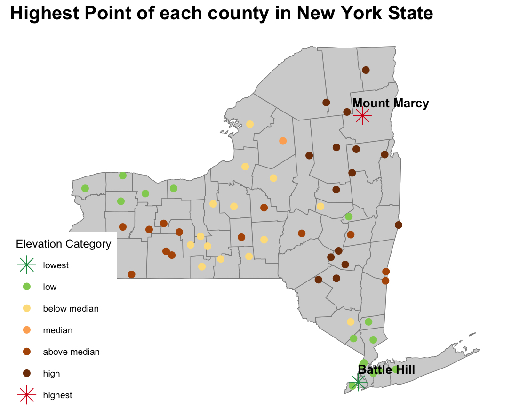
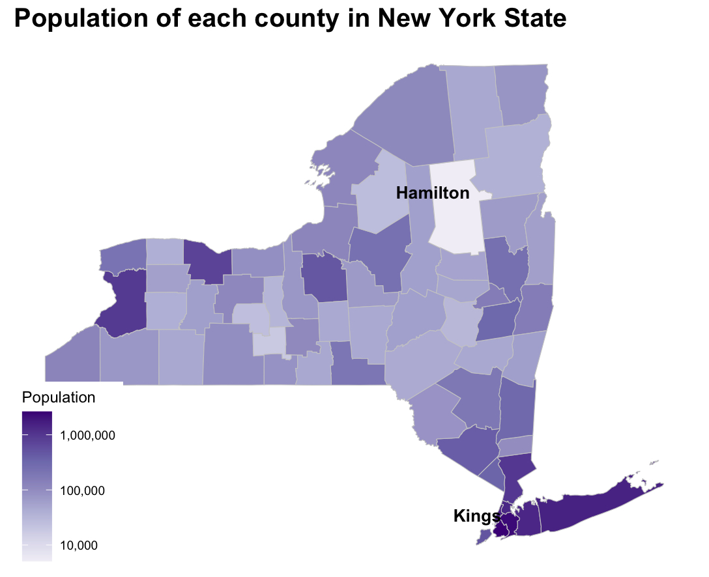
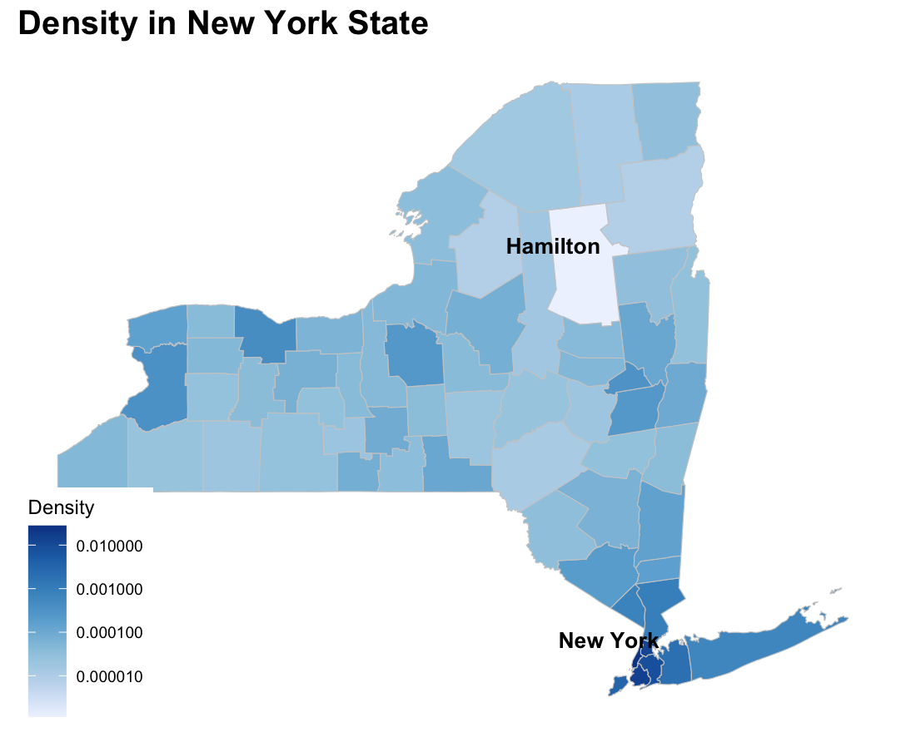

#1Include the map of New York counties and color-coded high points, with the highest point labeled. Which are the highest and lowest high points, and what are their elevations?

The highest point is Mount Marcy that is located in Essex County. The lowest point is Battle Hill that is located in Kings County.

#2Include the map of county population by county. What are the most and least populous counties, by name?

#3Include the map of county population density. What are the most and least densely populated counties, by name? 
